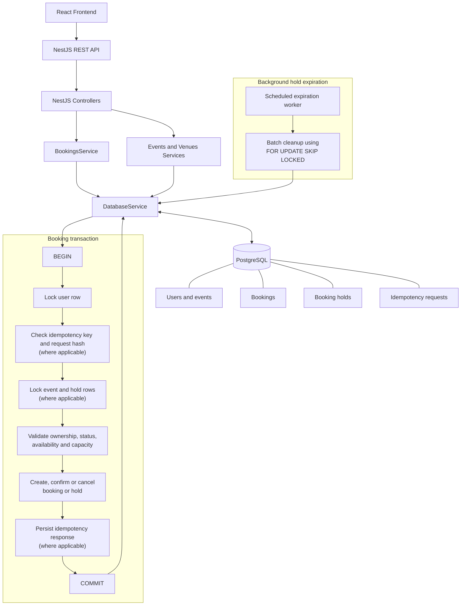

# Concurrency-Safe Event Booking System

[](https://github.com/dannychen27/Event-Driven-Booking-System/actions/workflows/coverage-pages.yml)
[](https://dannychen27.github.io/Event-Driven-Booking-System/)
[](https://github.com/dannychen27/Event-Driven-Booking-System/commits/main/)

[](https://dannychen27.github.io/Event-Driven-Booking-System/)
[](https://dannychen27.github.io/Event-Driven-Booking-System/)

[](https://dannychen27.github.io/Event-Driven-Booking-System/backend/)
[](https://dannychen27.github.io/Event-Driven-Booking-System/backend/)

[](https://dannychen27.github.io/Event-Driven-Booking-System/backend/)
[](https://dannychen27.github.io/Event-Driven-Booking-System/backend/)
[](https://dannychen27.github.io/Event-Driven-Booking-System/backend/)
[](https://dannychen27.github.io/Event-Driven-Booking-System/backend/)

[](https://dannychen27.github.io/Event-Driven-Booking-System/frontend/)
[](https://dannychen27.github.io/Event-Driven-Booking-System/frontend/)

[](https://dannychen27.github.io/Event-Driven-Booking-System/frontend/)
[](https://dannychen27.github.io/Event-Driven-Booking-System/frontend/)
[](https://dannychen27.github.io/Event-Driven-Booking-System/frontend/)
[](https://dannychen27.github.io/Event-Driven-Booking-System/frontend/)


## Project Links

- **[Live Demo](#live-demo)** — Try the deployed application.
- **[Screenshots](#screenshots)** — View the application's interface.
- **[Architecture](#architecture)** — Explore the system design and engineering decisions.
- **[Local Setup](#quick-start)** — Run the application locally.
- **[API Documentation](#api-endpoints)** — Explore the REST API.
- **[Test Coverage](#code-coverage)** — View automated test coverage reports.

## Overview

A full-stack event booking system built with React, NestJS, and PostgreSQL.
The project explores the design of a booking platform, from database constraints
and transaction safety to frontend/backend integration and automated testing.

This project was inspired by an admin system I debugged during my
summer 2022 full-stack development internship at Sky View Suites.

## Live Demo

**Status:** Deployment in progress.

The publicly accessible demo will be available here once deployment is complete.

**Application:** Coming soon

## Screenshots

Screenshots of the application's interface will be added here.

## Demo Instructions

The public demo provides access to a preconfigured instance of the booking application.

### Demo Account

- **Email:** Coming soon
- **Password:** Coming soon

### Available Workflows

- Browse events and venues.
- Check event availability.
- Create and manage booking holds.
- Confirm or cancel bookings.
- Search for events using natural language.

### Demo Environment

- Frontend: Coming soon
- Backend API: Coming soon
- Database: PostgreSQL

## Features

- [x] **Event and venue browsing**: browse available events and their associated venues.
- [x] **Event availability**: view the remaining capacity for an event.
- [x] **Natural-language event search**: search for events using natural-language queries, with supported filters for keywords and date ranges; requires a configured `GEMINI_API_KEY`.
- [x] **Booking management**: create and cancel event bookings.
- [x] **Booking history**: view a user's previous and current bookings.
- [x] **Booking validation**: prevent duplicate bookings, schedule conflicts, and bookings that exceed event capacity.
- [x] **Booking hold expiration**: automatically expire stale booking holds through scheduled cleanup.
- [x] **Client-side form validation**: validate booking input before submitting requests.
- [ ] **Responsive user interface**: support common desktop and mobile layouts.
- [x] **REST API integration**: connect the frontend to the backend through REST endpoints.
- [x] **Booking ownership validation**: check that a booking belongs to the specified user before allowing cancellation.
- [x] **Transactional booking protection**: use database transactions and row-level locking to protect against double-booking.
- [x] **Automated testing**: test the frontend, backend, integration workflows, and end-to-end application flows.

## Engineering Highlights

### Concurrency-Safe Booking

- Use PostgreSQL transactions and row-level locking to protect event capacity.
- Serialize conflicting booking operations to prevent concurrent overbooking.

### Idempotency

- Support idempotency keys for booking creation and hold confirmation.
- Replay stored responses for repeated requests with matching payloads.
- Reject reuse of an idempotency key with a different request payload.

### Booking Lifecycle

- Implement temporary booking holds with a 10-minute expiration period.
- Automatically expire stale holds through scheduled batch cleanup.
- Use `FOR UPDATE SKIP LOCKED` to coordinate background cleanup.

### Observability

- Use structured logging and request correlation to improve backend diagnostics.

### AI-Powered Search

- Interpret natural-language event queries using Gemini.
- Convert user intent into structured search constraints and clarification requests.

## Architecture

The application currently uses a layered full-stack architecture:
a React frontend communicates with a NestJS backend through a REST API,
and the backend retrieves and persists data in PostgreSQL.

Kafka-based event-driven processing is planned for a future phase
and is not part of the current request flow.

### Frontend

The frontend uses React, TypeScript, and Vite to provide the user interface
for browsing events and venues, creating bookings, checking event availability,
and viewing booking history.
It also communicates with the backend through REST API requests.


### Backend

The NestJS backend is organized into feature-based modules:

- **Events**: Event retrieval, availability, and natural-language search.
- **Venues**: Venue retrieval.
- **Bookings**: Booking creation, cancellation, and booking history.
- **Database**: PostgreSQL database connection and access

The backend exposes the REST API, validates requests, applies business rules,
and coordinates database operations.


### Database

PostgreSQL stores users, venues, events, and bookings.
Primary keys, foreign keys, constraints, and indexes support data integrity.
Booking operations use database transactions and row-level locking to help
prevent conflicting operations and concurrent overbooking.

The `DatabaseService` manages transaction lifecycle and PostgreSQL
connection handling, while booking services execute business operations
within those transactions.

### Request Flow

A typical request follows this path:



> Transaction steps vary by operation.
> Idempotency checks and response persistence apply to booking creation and hold confirmation;
> row locks are acquired as required by each operation.

- The controller receives the request and delegates processing to the appropriate service.
- The service applies business rules and coordinates database operations, such as reading from and writing to the database.
- The controller then returns the backend response to the frontend.


### Booking Lifecycle and Reliability

#### Booking Creation

- A booking request starts a database transaction.
- The service locks the relevant user and event rows to serialize conflicting operations.
- It checks for an existing idempotency record when an idempotency key is supplied.
- It expires stale holds and validates capacity, existing bookings, and overlapping active holds.
- The booking and its idempotency response are persisted in the same transaction.
- The transaction commits only after all required operations succeed.

#### Temporary Booking Holds

- A user can create a temporary hold on an event.
- Holds expire automatically after 10 minutes if they are not confirmed.
- Active holds count toward event capacity and participate in availability checks.
- Partial unique indexes prevent a user from holding the same event more than once.
- A scheduled background worker periodically expires stale holds in batches using `FOR UPDATE SKIP LOCKED`.

#### Hold Confirmation and Cancellation

- Confirming a hold validates ownership and locks the relevant user, event, and hold rows.
- A successful confirmation creates a booking and updates the hold within the same transaction.
- An expired hold is marked expired before the request returns a conflict response.
- Hold cancellation similarly validates ownership and updates the hold status transactionally.
- Booking cancellation removes the booking within a transaction after ownership validation and the necessary row locking.

#### Idempotency and Transaction Safety

- Booking creation and hold confirmation support idempotency keys.
- Idempotency records are scoped to the user and operation.
- Repeating a request with the same key and request payload replays the stored response.
- Reusing a key with a different request payload returns a conflict.
- Booking changes and their corresponding idempotency records are committed atomically.
- Database transactions roll back on failure, and database connections are released after transaction completion.


### Why Event-Driven Architecture?

The planned event-driven architecture aims to decouple booking operations from
downstream services.

For example, after a booking is created, the booking service could publish a
`booking.created` event to Kafka.
Independent notification and analytics services could process that event
without requiring the booking service to call each consumer service directly.

This would make it easier to add downstream functionality while keeping the
core booking workflow less tightly coupled.

## Technology Stack

### Current

| Layer | Technologies |
| --- | --- |
| Frontend | React, TypeScript, Vite |
| Backend | NestJS, TypeScript |
| Database | PostgreSQL |
| Database Tooling | node-postgres (`pg`), SQL |
| Testing | Vitest, Jest, Supertest, Testing Library |

### Planned

| Layer | Technologies |
| --- | --- |
| Frontend (alternative) | Angular, TypeScript |
| Event streaming | Apache Kafka |
| Systems language | C++ |
| Containerization | Docker |
| Orchestration | Kubernetes |

## API Endpoints

The application exposes its functionality through a REST API implemented with NestJS.

### User Endpoints

| Method | Endpoint | Description |
| --- | --- | --- |
| `GET` | `/users/:id/bookings` | Retrieve a user's booking history |

### Event Endpoints

| Method | Endpoint | Description |
| --- | --- | --- |
| `GET` | `/events` | Retrieve all events |
| `GET` | `/events/:id` | Retrieve a specific event |
| `GET` | `/events/:id/availability` | Retrieve event availability |
| `POST` | `/events/:id/book` | Create a booking for an event |
| `POST` | `/events/natural-language-search` | Search for events using a natural-language query (requires a configured Gemini API key) |

**How AI search works:** Describe what kind of event you're looking for in natural language.
Gemini interprets your request, identifies event preferences and date constraints, and ranks candidate events by relevance.
Events outside the requested date range are filtered out before ranking, and irrelevant events may be excluded.

This feature requires a valid `GEMINI_API_KEY` and an available Gemini service.
Temporary service failures may result in a `503 Service Unavailable` response.

Natural-language search accepts a JSON body containing a non-empty `query` string of up to 500 characters.

Example request body:

```json
{
  "query": "Find networking events before November 1"
}
```

The endpoint returns a `400 Bad Request` if:
- `query` is missing,
- `query` is empty,
- `query` is not a string, or
- `query` is longer than 500 characters.

### Venue Endpoints

| Method | Endpoint | Description |
| --- | --- | --- |
| `GET` | `/venues` | Retrieve all venues |
| `GET` | `/venues/:id` | Retrieve a specific venue |

### Booking Endpoints

| Method | Endpoint | Description |
| --- | --- | --- |
| `POST` | `/booking-holds/:id/confirm` | Confirm an active booking hold and create a booking |
| `DELETE` | `/booking-holds/:id` | Cancel an active booking hold |
| `DELETE` | `/bookings/:id` | Cancel a booking |

## Testing

The project includes four categories of automated tests:

- **Backend tests**: Unit and API tests for backend services and endpoints.
- **Frontend tests**: Component and page tests using Vitest.
- **Integration tests**: Backend integration tests using a test PostgreSQL database.
- **End-to-end tests**: Tests of complete application workflows using a test PostgreSQL database.

### Run All Tests

Run the complete test suite from the project root:

```bash
npm test
```

### Run Specific Test Suites

| Test suite | Command |
| --- | --- |
| Backend | `npm run test:backend` |
| Frontend | `npm run test:frontend` |
| Integration | `npm run test:integration` |
| End-to-end | `npm run test:e2e` |

The integration and end-to-end test commands automatically recreate the
`booking_system_test` database, load the schema, and seed test data before
running their respective test suites.

Ensure PostgreSQL is running and accessible with the required connection
settings before running these commands.

## Code Coverage

Generate backend and frontend coverage reports from the project root.

```bash
npm run coverage
```

This runs the backend Jest coverage suite followed by the frontend
Vitest coverage suite.

GitHub Actions publishes detailed HTML coverage reports and
uploads coverage reports as downloadable workflow artifacts.

View the latest published coverage reports:

- [Backend coverage report](https://dannychen27.github.io/Event-Driven-Booking-System/backend/)
- [Frontend coverage report](https://dannychen27.github.io/Event-Driven-Booking-System/frontend/)
- [Coverage workflow runs and artifacts](https://github.com/dannychen27/Event-Driven-Booking-System/actions/workflows/coverage-pages.yml)

Backend coverage is measured using Jest,
while frontend coverage uses Vitest with the V8 coverage provider.
Aggregate figures include test-support files and other files included by each coverage configuration.

## Quick Start

### Prerequisites

Before running the project, the following software is required:

- **Node.js 20.19.0 or later**: required by the frontend build tooling.
- **npm**: used to install dependencies and run the project scripts.
- **PostgreSQL**: used as the application's relational database.
- **Git**: used to clone the repository and manage the project source code.

I recommend using an active LTS version of Node.js, such as Node.js 22.x.

### 1. Install Dependencies

Start from a fresh `git checkout`:

```bash
git clone <repository-url>
cd <project-directory>
```

From the project root, install frontend and backend dependencies:

```bash
npm install
npm install --prefix "4. backend"
npm install --prefix "3. frontend"
```

After installation, configure the environment variables and
database before running the application.

### 2. Configure the Environment Variables

Copy the example environment file:

```bash
cp .env.example .env
```

Update `.env` with your local PostgreSQL connection settings.
Set `DB_HOST`, `DB_PORT`, `DB_NAME`, `DB_USER`, and `DB_PASSWORD`
as appropriate for your setup.

To use AI-powered natural-language search, configure `GEMINI_API_KEY`.

Then update `.env` with the PostgreSQL credentials for your local database:

```env
DB_HOST=localhost
DB_PORT=5432
DB_NAME=booking_system
DB_USER=<your-postgresql-username>
DB_PASSWORD=<your-postgresql-password>
```

The environment variables control the following database connection settings:

| Variable | Description | Default |
| --- | --- | --- |
| `DB_HOST` | PostgreSQL server host | `localhost` |
| `DB_PORT` | PostgreSQL server port | `5432` |
| `DB_NAME` | Application database name | `booking_system` |
| `DB_USER` | PostgreSQL username | — |
| `DB_PASSWORD` | PostgreSQL password | — |

### 3. Initialize the Database

Ensure PostgreSQL is running, then follow the [Database Setup](#database-setup) instructions below.

For a quick local development setup, the `setup.sh` script recreates `booking_system` and loads the schema, indexes, and development seed data. For a clean portfolio dataset, use `setup-showcase.sh` to create a separate `booking_system_showcase` database.

**Warning:** The development `setup.sh` script deletes existing data in `booking_system`. Use it only when you intend to reset that database.

### 4. Start the Application

I run the frontend and backend separately during development.

In one terminal, start the backend:

```bash
npm run start:dev --prefix "4. backend"
```

In another terminal, start the frontend:

```bash
npm run dev --prefix "3. frontend"
```

Open the frontend URL printed by Vite in your terminal (typically `http://localhost:5173`).
The backend runs on `http://localhost:3000` by default.

## Database Setup

- `setup.sh` — drops and recreates `booking_system`, then loads the schema, indexes, and development seed data. It does not run constraint tests.
- `setup-showcase.sh` — creates `booking_system_showcase` without dropping or overwriting an existing database, then loads the schema, indexes, showcase venues and events, the demo user, and four confirmed bookings.
- `setup.sql` — loads the schema, indexes, seed data, and constraint tests into an existing database.
- `schema.sql` — defines the database schema.
- `seed data/seed.sql` — provides seed data for development and testing.
- `seed data/showcase.sql` — loads the portfolio showcase venues and events into an initialized database. It is run automatically by `setup-showcase.sh`, but not by the development setup or reset scripts.
- `seed data/showcase-bookings.sql` — creates the showcase demo user and four confirmed bookings. It is loaded only by `setup-showcase.sh`.
- `reset.sql` — drops the application tables, then reruns `setup.sql` to restore the schema, indexes, seed data, and constraint tests. It does not drop or recreate the database itself.

### Option 1: Using `setup.sh`

Run the shell script from the `2. data model` directory:

```bash
cd "2. data model"
./setup.sh
```

**Warning:** This script drops and recreates `booking_system`, deleting its existing data.
Use it only when you intend to reset that database.

### Option 2: Create the Portfolio Showcase Database

From the project root, run:

```bash
DB_NAME=booking_system_showcase "2. data model/setup-showcase.sh"
```

This creates a new `booking_system_showcase` database and loads the schema, indexes, eight illustrative showcase events, one demo user, and four confirmed bookings. It does not load development fixtures or booking holds. The script is create-only: it refuses any database name other than `booking_system_showcase` and does not drop or overwrite an existing database.

To run the application against this database, set `DB_NAME=booking_system_showcase` in your root `.env` file and restart the backend. Keep `DB_USER`, `DB_PASSWORD`, `DB_HOST`, and `DB_PORT` configured for your PostgreSQL instance.

### Loading the Showcase Dataset into an Existing Database

If you intentionally want to add or update the showcase venues and events in an already initialized database, run this from the project root:

```bash
psql -X -v ON_ERROR_STOP=1 -d booking_system -f "2. data model/seed data/showcase.sql"
```

`showcase.sql` is safe to rerun. It does not create users, bookings, or booking holds. This option layers showcase data onto the selected database; use the separate showcase database above when you want the portfolio dataset isolated from development fixtures.


### Option 3: Manually through `psql`

Run the following commands from the project root to switch to the database directory before starting `psql`:

```bash
cd "2. data model"
```

Start PostgreSQL:

```bash
psql
```

Create the application database and connect to it.
If `booking_system` already exists, skip the `CREATE DATABASE` command and
connect to the existing database instead:

```sql
CREATE DATABASE booking_system;
\c booking_system
```

**Warning:** These commands are intended for a fresh development or test database.
If `booking_system` already contains data, use a separate test database rather
than rerunning the setup scripts against it.

Load the schema, indexes, seed data, and constraint tests:

```text
\i setup.sql
```

Note: The constraint-test scripts perform database operations to
verify constraint enforcement.
Run them only in a development or test database, not against
production data.

### Connecting to the Database Later

```bash
psql booking_system
```

### Viewing Tables

List the tables in the database with:

```text
\dt
```

After initialization, configure the database connection variables in `.env` so the backend can connect to PostgreSQL.

## Linting

I use ESLint to check the frontend and backend code.

Run linting for the entire project from the project root:

```bash
npm run lint
```

### Run Specific Linters

| Target | Command |
| --- | --- |
| Backend | `npm run lint:backend` |
| Frontend | `npm run lint:frontend` |


## Building

I use the root build script to build both the backend and frontend:

```bash
npm run build
```

### Build Specific Projects

| Target | Command |
| --- | --- |
| Backend | `npm run build:backend` |
| Frontend | `npm run build:frontend` |

## Project Structure

```text
Event-Driven Booking System/
├── 0. documentation/               # Architecture and technology documentation
├── 0. tests/
│   ├── backend/                    # Backend unit and API tests
│   ├── frontend/                   # Frontend component and page tests
│   ├── integration/                # Backend integration tests
│   ├── end-to-end/                 # End-to-end application tests
│   ├── mocks/                      # Shared test mocks
│   └── utils/                      # Shared test utilities
├── 1. api endpoints/               # API specifications and design documentation
├── 2. data model/                  # Database schema, setup, seeds, and design
├── 3. frontend/
│   └── src/
│       ├── api/                    # Backend API clients
│       ├── components/             # Reusable React components
│       ├── pages/                  # Application pages
│       ├── styles/                 # Component and page styling
│       ├── types/                  # TypeScript domain types
│       └── utils/                  # Shared frontend utilities
├── 4. backend/
│   └── src/
│       ├── bookings/               # Booking module and business logic
│       ├── database/               # PostgreSQL database connection
│       ├── events/                 # Event module and business logic
│       └── venues/                 # Venue module and business logic
├── 5. shared/
│   └── src/
│       └── time-of-day.ts          # Shared time-of-day types, intervals, and utilities
├── for the resume/                 # Resume-related project materials
├── instructions/                   # Project instructions
├── scheduling/                     # Scheduling-related project materials
├── scripts/                        # Verification and development scripts
│   └── verify-logs.sh              # Validates test, lint, build, and coverage logs
├── test-logs/                      # Test and verification logs
├── .env.example                    # Example environment configuration
├── package.json                    # Root project scripts and dependencies
├── package-lock.json               # Root npm dependency lockfile
├── skills-lock.json                # Skills dependency lockfile
├── tsconfig.json                   # Root TypeScript configuration
├── tsconfig.test.json              # TypeScript configuration for tests
└── README.md                       # Project documentation
```

The `5. shared` directory contains TypeScript code shared between the
frontend and backend. It currently provides common time-of-day definitions
and utilities to keep time-filtering behavior consistent across both applications.

## Known Limitations

- **Live Gemini integration is not yet verified end to end.** During development, requests returned `503 UNAVAILABLE` from the provider. Successful live operation remains unverified.
- **Authentication is not implemented.** The booking service checks that the supplied user ID owns a booking before cancellation, but requests do not establish that the caller is actually that user.
- **Kafka-based event processing is planned for Phase 2.**
- **The current deployment workflow is intended for local development.**

### Dependency Audit

- The root dependency tree reports **0 vulnerabilities**.
- The frontend dependency audit reports **11 vulnerabilities: 9 moderate and 2 high**, all affecting development dependencies. Its production-only audit reports **0 vulnerabilities**.
- The backend dependency audit reports **20 vulnerabilities: 17 moderate and 3 high**. The production-only audit reports **3 high-severity vulnerabilities**, involving `body-parser` and `multer`.
- Some findings have non-breaking fixes available through `npm audit fix`. Resolving all findings may require breaking dependency upgrades, so remediation requires compatibility testing.

## Project Roadmap

I plan to develop the project in three major phases, with each phase building on the previous one.

For the current implementation status, planned improvements, and deferred work,
see [PROJECT_ROADMAP.md](0.%20documentation/PROJECT_ROADMAP.md).

### Phase 1 — Make the Booking System Work

**Goal:** Build the core booking system with React, a REST API, and PostgreSQL.

- [x] Establish users
- [x] Establish events and venues
- [x] Implement event availability
- [x] Implement booking creation and cancellation
- [x] Implement booking history
- [x] Add transactional protection against double-booking
- [x] Build the basic frontend

### Phase 1 Follow-up — AI-Powered Natural-Language Event Search

The core search feature and relative-date interpretation are implemented.
Provider error handling and rate limiting remain.

- [x] **Improve relative-date interpretation**
  - [x] Provide the current date and an explicit timezone to the AI interpreter.
  - [x] Ensure queries such as "this weekend" produce appropriate `startAfter` and `startBefore` filters.
  - [x] Add tests for relative-date interpretation and timezone boundaries.
  - [x] Test date-filter validation, including invalid dates and reversed date ranges.

- [ ] **Harden AI provider error handling**
  - [x] Detect missing API-key configuration.
  - [x] Test missing API-key detection.
  - [x] Map provider `503` failures to a `ServiceUnavailableException`.
  - [x] Return a generic client-facing message for handled `503` failures.
  - [ ] Return an appropriate, actionable client-facing error for missing API-key configuration.
  - [ ] Normalize other upstream provider failures into appropriate HTTP responses.
  - [ ] Retain useful server-side diagnostics without exposing internal provider details to clients.
  - [ ] Add tests for additional provider failures and client-facing error responses.

- [ ] **Add rate limiting to the AI search endpoint**
  - [ ] Protect `POST /events/natural-language-search` against excessive requests.
  - [ ] Return an appropriate HTTP response when the rate limit is exceeded.
  - [ ] Add tests for rate-limit behavior.

- [ ] **Verify live Gemini integration**
  - [ ] Confirm the configured Gemini model responds successfully using the free-tier configuration.
  - [ ] Test a representative natural-language query end to end.
  - [ ] Verify that provider failures produce the expected client-facing error response.


### Planned Frontend Expansion — Angular

**Goal:** Develop an alternative Angular frontend while preserving the existing React implementation.

- [ ] Create a separate `feature/angular-frontend` branch.
- [ ] Reimplement existing React components and application workflows using Angular.
- [ ] Reuse the existing NestJS backend, PostgreSQL database, and Gemini API integration.
- [ ] Preserve existing API contracts and application behavior.
- [ ] Port frontend unit tests and verify feature parity.

I will maintain the Angular implementation independently from the existing
React frontend, with both implementations sharing the same backend.


### Phase 2 — Make It Distributed

**Goal:** Introduce Kafka and event-driven communication.

```text
        Booking Service
             │
             │ booking.created
             │ booking.cancelled
             │
             ▼
           Kafka
       ↙         ↘
Notifications   C++ Analytics
   Consumer        Consumer
```

#### Planned Work

- [ ] Publish `booking.created` events
- [ ] Publish `booking.cancelled` events
- [ ] Implement Kafka producers and consumers
- [ ] Build the notification consumer
- [ ] Build the C++ analytics consumer
- [ ] Implement retries
- [ ] Implement idempotent event processing
- [ ] Handle consumer failures
- [ ] Implement authentication and broader authorization

### Phase 3 — Make It Look Professional

**Goal:** Containerize and deploy the distributed system while improving reliability and observability.

```text
                    Kubernetes
                         │
        ┌────────────────┼────────────────┐
        ▼                ▼                ▼
       API        Notification      C++ Analytics
        │             Consumer          Consumer
        │                ▲                ▲
        │                │                │
        │             ┌──┴────────────────┴──┐
        │             │        Kafka          │
        │             └──────────▲────────────┘
        │                        │
        ▼                        │
    PostgreSQL                   │
        ▲                        │
        └──────── Booking Service┘
```

#### Planned Work

- [ ] Add responsive user interface
- [ ] Add Docker Compose
- [ ] Add Kubernetes manifests
- [ ] Add health checks
- [x] Add structured logging
- [x] Expand API and integration tests
- [x] Add CI/CD
- [ ] Add load and failure tests
- [x] Add an architecture diagram
- [x] Expand project documentation


I intend to stop once these phases are complete rather than continuously
adding infrastructure and services beyond the project's core goals.
